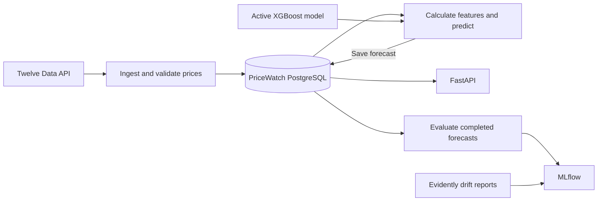

# PriceWatch | Market Data Engineering & ML Forecasting Platform

PriceWatch forecasts the next trading session’s percentage return for Apple (AAPL), Microsoft (MSFT), and NVIDIA (NVDA). It follows each forecast through its lifecycle: collecting prices, generating a prediction, serving it through an API, and measuring its error once the actual closing price arrives.

The project runs locally with Python, PostgreSQL, Airflow, XGBoost, MLflow, Evidently, FastAPI, and Docker Compose.

## How the pipeline works



The Airflow DAG is scheduled for 7 p.m. New York time on weekdays while the scheduler is running.

1. **Ingestion.** Fetch daily prices from Twelve Data. Each company resumes from its latest stored date, so ingestion can catch up after the laptop has been offline. Upserts allow a repeated run to update existing rows.
2. **Validation.** Check that each expected company has prices, that open and close fall within the daily price range, that company/date pairs are unique, and that the latest prices match the expected trading session.
3. **Prediction.** Calculate features from each company’s price history and predict the return for the next trading session. Save the prediction, feature date, target date, and model run ID in PostgreSQL.
4. **Performance monitoring.** Once the target session’s closing price is available, calculate the realized return and compare it with the forecast. Log model error, baseline error, and evaluated prediction count to the corresponding MLflow run.
5. **Drift monitoring.** When a check is due, compare the most recent 30 observations per company with the active model’s training reference. Evidently calculates Wasserstein drift scores, and MLflow stores the scores and HTML report. A successful check is due again after seven days. The drift threshold is provisional, and retraining is manually triggered.

## Model training and selection

The model uses four inputs: daily return, five-session mean return, five-session return standard deviation, and intraday return. The target is the percentage change from the current closing price to the next trading session’s closing price.

Training runs separately from the daily DAG. Rows are split chronologically into training, validation, and test periods. The last date in both the training and validation splits is excluded so the next-session target does not cross the split boundary. XGBoost uses the validation period for early stopping.

The training script handles two cases:

- **First model.** When `model.pkl` does not exist, train and evaluate the candidate, log its error and the zero-return baseline’s error, and save it as the initial model. The previous-model MAE is recorded as `null` in `evaluation.json`.
- **Subsequent models.** Evaluate the candidate and the active model on the same comparison rows. Promote the candidate only if its mean absolute error is lower than both the active model’s error and the zero-return baseline’s error. Upload the candidate artifacts and training reference before replacing the active model.

One recorded comparison produced the following results:

| Forecast | MAE in percentage points |
| --- | ---: |
| Zero-return baseline | 1.6457 |
| Active model | 1.6473 |
| Candidate model | 1.6485 |

Lower is better. The baseline had the lowest error on this period. The candidate was rejected, and the prediction pipeline continued using the previous model.

## Database and API

`schema.sql` defines the three project tables. The PostgreSQL service mounts it into the image’s initialization directory so it runs when PostgreSQL initializes an empty data volume.

| Table | Purpose |
| --- | --- |
| `companies` | Company identifiers and market metadata |
| `stock_prices` | Daily prices and volume for each company |
| `stock_predictions` | Forecasts, feature and target dates, and the model run ID |

`GET /predictions/{symbol}` returns the latest stored prediction for the requested symbol. The response includes `symbol`, `feature_date`, `target_date`, `predicted_return`, and `model_run_id`. A symbol with no saved prediction returns HTTP 404.

## Run an already configured installation

Start Docker Desktop and run the following from the project root:

```sh
docker compose up -d --build
```

| Service | Local URL |
| --- | --- |
| Airflow | http://localhost:8080 |
| MLflow | http://localhost:5000 |
| FastAPI interactive docs | http://localhost:8000/docs |
| API health | http://localhost:8000/health |
| Latest AAPL prediction | http://localhost:8000/predictions/AAPL |

To shut down the project:

```sh
docker compose down
```

To start it again with the existing images:

```sh
docker compose up -d
```

## First installation

The repository includes source code, dependency files, Compose configuration, and the database schema. Each installation generates its own price history, model, and MLflow artifacts.

The intended first-run sequence is:

1. Copy `.env.example` to `.env`. Supply a Twelve Data API key, database password, Airflow Fernet key, and JWT secret.
2. Start PostgreSQL and MLflow with `docker compose up -d pricewatch-db mlflow`. On an empty PostgreSQL volume, `schema.sql` initializes the project tables.
3. Using a Python environment with the project’s ingestion and training dependencies, run historical ingestion to populate `companies` and `stock_prices`.
4. Run `python features.py` from the project root. The first training run creates `model.pkl` and records its training reference in MLflow.
5. Start the full stack with `docker compose up -d --build`. Unpause the PriceWatch DAG and trigger it to generate the first saved predictions.

Start the full Airflow stack after the initial model has been created because the Airflow configuration mounts `model.pkl`.

## Verification and scope

The complete daily DAG ran successfully on the configured local installation. After shutting down and restarting the Compose project, the API returned the saved prediction, an existing MLflow artifact remained accessible, and Airflow retained the earlier successful DAG run.

The schema initialization and first-model logic are implemented. Cloud hosting is future work.